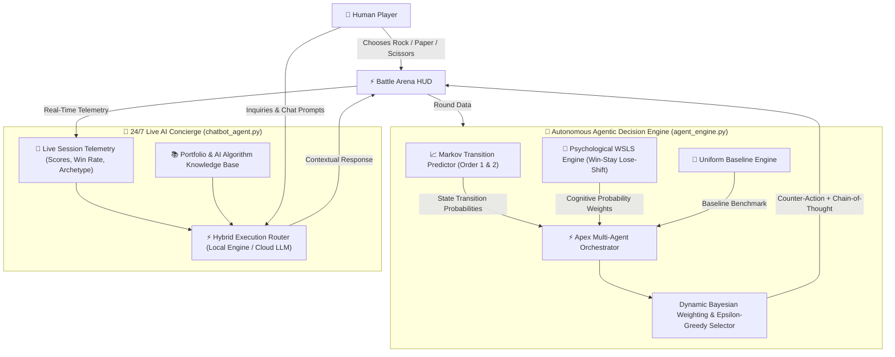

# ⚡ ApexRPS: Autonomous Agentic Decision Platform & 24/7 Live AI Concierge

<div align="center">

[](https://apex-game.streamlit.app/)


<br/>

**Transforming a classic game into an advanced showcase of Statistical Machine Learning, Empirical Game Theory, and Autonomous Multi-Agent Systems.**

[🚀 **Try Live Web App**](https://apex-game.streamlit.app/) • [System Specifications](specs.md) • [AI Architecture](#-agentic-ai-architecture) • [Hire Developer](#-developed-by-hadi-seelro)

</div>

---

## 🌟 Why This Project Stands Out

Most Rock-Paper-Scissors projects on GitHub are trivial 15-line scripts running `random.choice()`. 

**ApexRPS** redefines the paradigm into an **enterprise-grade Agentic AI application**:
- 🧠 **Multi-Agent Decision Intelligence:** An ensemble of Markov Transition matrices and behavioral *Win-Stay, Lose-Shift* (WSLS) heuristics that anticipate human moves with escalating precision.
- ⚡ **Real-Time Chain-of-Thought (CoT):** The agent transparently streams its probability calculations, cognitive deliberations, and tactical confidence metrics before executing each move.
- 💬 **24/7 Live AI Customer Concierge:** An always-online assistant that tracks live match telemetry, explains game theory, and represents developer **Hadi Seelro** for client project inquiries.
- 🎨 **Modern Cyberpunk Glassmorphism:** Designed with sleek blur backdrops, neon glow accents, interactive gesture cards, and live analytics charts.

---

## 🎮 Key Features

| Feature | Description |
| :--- | :--- |
| **⚔️ Multi-Personality Arena** | Choose your adversary: *Novice (Random Baseline)*, *Pattern Predictor (Markov)*, *Psychological Agent (WSLS)*, or the master *Apex Autonomous Agent*. |
| **🔍 Real-Time Thought Stream** | View live Bayesian probabilities $P(\text{Rock})$, $P(\text{Paper})$, $P(\text{Scissors})$ and deliberative reasoning logs on every round. |
| **💬 24/7 Contextual Concierge** | Embedded AI chatbot with zero-crash local execution + optional Cloud LLM. Retains complete context of live scorelines, win rates, and player archetypes. |
| **📊 Cognitive Profiling** | Telemetry engine categorizes players into archetypes (*Predictable Pattern*, *Dynamic Shifter*, *Adaptive Strategist*) based on historical entropy. |
| **📥 Telemetry Export** | Download your complete session ledger as clean, structured JSON for data science exploration. |

---

## 🧠 Agentic AI Architecture



---

## 📐 Mathematical & Cognitive Foundations

### 1. Nash Equilibrium vs. Human Behavioral Biases
Under classic game theory, the mixed-strategy Nash Equilibrium is strictly uniform:
$$\sigma^* = \left(\frac{1}{3}, \frac{1}{3}, \frac{1}{3}\right)$$

However, human players are governed by bounded cognitive heuristics:
- **Inaugural Move Bias:** Over **38%** of humans open with **Rock** due to psychological priming.
- **Win-Stay:** Players who win a round repeat their move with $P > 0.60$.
- **Lose-Shift:** Defeated players predictably abandon their choice and cycle toward the gesture that would have overcome the AI's winning move.

### 2. Markov Chain State Machine (Order 1 & 2)
Conditional transition probabilities are estimated dynamically with Laplace smoothing:
$$P(M_t = j \mid M_{t-1} = i) = \frac{C(i, j) + 1}{\sum_{k \in \{R, P, S\}} (C(i, k) + 1)}$$

### 3. Dynamic Bayesian Ensemble Synthesis
$$P_{\text{ensemble}}(M_t) = w_{\text{Markov}}(n) \cdot P_{\text{Markov}}(M_t) + w_{\text{Psych}}(n) \cdot P_{\text{Psych}}(M_t)$$

- For $n < 4$: $w_{\text{Psych}} = 0.70$ (heuristic dominant).
- For $n \ge 4$: $w_{\text{Markov}} = 0.65$ (data-pattern dominant).

---

## 🌐 Live Web Demo

You can experience and interact with the Autonomous Agent and 24/7 AI Concierge right now in your browser without local installation:

<div align="center">

[](https://apex-game.streamlit.app/)

👉 **Direct URL:** [https://apex-game.streamlit.app/](https://apex-game.streamlit.app/)

</div>

---

## 🚀 Quick Start (Local Setup)

### 1. Clone the Repository
```bash
git clone https://github.com/SainBux-HadiSeelro/apex-game.git
cd apex-game
```

### 2. Run with Streamlit
Ensure Python 3.12+ is installed:
```bash
pip install -r pyproject.toml
# OR simply
pip install streamlit pandas
```

Launch the platform:
```bash
python -m streamlit run app.py
```
Open your browser at `http://localhost:8501`.

*(Optional)* To enable OpenAI API for the concierge chatbot, set your environment variable:
```bash
export OPENAI_API_KEY="your-api-key"   # Linux/macOS
$env:OPENAI_API_KEY="your-api-key"     # Windows PowerShell
```
> **Note:** An API key is **100% optional**. The 24/7 Concierge features a zero-failure autonomous local engine that functions offline!

---

## 📁 Project Structure

```
├── app.py               # Modern Streamlit Cyberpunk UI & Reactive HUD
├── agent_engine.py      # Markov, WSLS & Apex Multi-Agent Decision Engine
├── chatbot_agent.py     # 24/7 Context-Injected Live AI Concierge Agent
├── specs.md             # Formal Engineering & Game Theory Specifications
├── pyproject.toml       # Python Dependency Specifications
└── README.md            # Portfolio Documentation & Architecture Showcase
```

---

## 👨‍💻 Developed by Hadi Seelro

<div align="center">

### **Hadi Seelro**
*Agentic AI Developer & Full-Stack Systems Engineer*

Specializing in **Autonomous Multi-Agent Architecture**, **Predictive Game Theory Platforms**, and **Enterprise LLM Workflows**.

[](https://github.com/SainBux-HadiSeelro)
[](https://github.com/SainBux-HadiSeelro)
[](https://linkedin.com)

</div>

### Available for:
- 🚀 **Autonomous AI Agent Systems** (Goal-directed, self-correcting agentic workflows)
- 📊 **Predictive Analytics & Game-Theoretic Platforms**
- ⚡ **Production Web Applications** (Streamlit, FastAPI, React, Next.js)
- 💬 **Enterprise RAG & Conversational AI Systems**

---

<div align="center">
Made with ❤️ by <b>Hadi Seelro</b>. Star ⭐ this repository if you found it inspiring!
</div>
