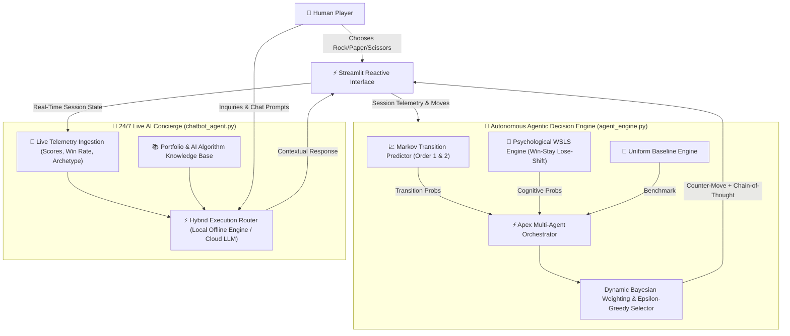

# 📜 Technical Specifications & System Architecture
## ApexRPS: Autonomous Agentic Decision Platform & 24/7 Live AI Concierge
**Architect & Developer:** Hadi Seelro  
**Specialization:** Agentic AI Systems & Intelligent Full-Stack Platforms  
**Version:** 2.0.0  
**Status:** Production-Ready  

---

## 1. Executive Summary & Objective

**ApexRPS** re-engineers the classical zero-sum game of Rock-Paper-Scissors into an enterprise-grade demonstration of **Statistical Machine Learning**, **Empirical Game Theory**, and **Autonomous Multi-Agent Orchestration**.

Standard implementations rely on simplistic, pseudo-random generators (`random.choice()`) exhibiting zero learning or state-awareness. ApexRPS implements:
1. **Dynamic Pattern Recognition:** 1st and 2nd Order Markov State Transition Matrices to capture human sequence dependency.
2. **Behavioral Psychology Modeling:** Operationalizing the *Win-Stay, Lose-Shift* (WSLS) cognitive heuristic established in human behavioral dynamics.
3. **Multi-Agent Ensemble & Introspection:** Combining heuristic and statistical agents through Bayesian dynamic weighting and outputting real-time chain-of-thought telemetry.
4. **24/7 Live Telemetry-Aware Concierge Agent:** An autonomous customer-facing agent that ingests live match telemetry, assists users, explains technical architecture, and acts as a portfolio representative for developer Hadi Seelro.

---

## 2. System Architecture

---

## 3. Mathematical & Game-Theoretic Specifications

### 3.1 Nash Equilibrium vs. Human Bounded Rationality
In game theory, the unique mixed-strategy Nash Equilibrium for Rock-Paper-Scissors is:
$$\sigma^* = \left(\frac{1}{3}, \frac{1}{3}, \frac{1}{3}\right)$$

If an opponent executes true uniform randomness, expected payoff is 0 regardless of counter-strategy. However, biological human agents exhibit **bounded rationality**, governed by cognitive shortcuts, emotional biases, and sequential conditioning:
- **Inaugural Move Bias:** Over 38% of initial human rounds favor **Rock** due to physical and psychological priming.
- **Win-Stay Heuristic:** Victorious players disproportionately repeat their winning gesture with $P > 0.60$.
- **Lose-Shift Heuristic:** Defeated players predictably abandon their losing move and shift to either the gesture that beat them or the gesture that would have beaten the opponent's previous move.

---

### 3.2 Markov Transition Matrices (Order 1 & 2)

#### First-Order Transitions:
Transition probabilities conditional on the player's immediately preceding move $M_{t-1}$:
$$P(M_t = j \mid M_{t-1} = i) = \frac{C(i, j) + \alpha}{\sum_{k \in \{R, P, S\}} (C(i, k) + \alpha)}$$
Where:
- $C(i, j)$ represents observed count of transition from move $i$ to $j$.
- $\alpha = 1$ is Laplace smoothing parameter preventing zero-probability deadlocks.

#### Second-Order Transitions:
Conditional on the two-step historical sequence $(M_{t-2}, M_{t-1})$:
$$P(M_t = k \mid M_{t-2} = i, M_{t-1} = j) = \frac{C(i, j, k) + 1}{\sum_{m} (C(i, j, m) + 1)}$$

---

### 3.3 Dynamic Bayesian Ensemble & Synthesis

The master agent (**Apex Autonomous Agent**) blends heuristics according to sample size $n = |\text{History}|$:

$$P_{\text{ensemble}}(M_t) = w_{\text{Markov}}(n) \cdot P_{\text{Markov}}(M_t) + w_{\text{Psych}}(n) \cdot P_{\text{Psych}}(M_t)$$

- **Early Game ($n < 4$):**  
  $$w_{\text{Psych}} = 0.70, \quad w_{\text{Markov}} = 0.30$$  
  *(Statistical sample size is insufficient; human psychological heuristics prevail).*
- **Mature Game ($n \ge 4$):**  
  $$w_{\text{Markov}} = 0.65, \quad w_{\text{Psych}} = 0.35$$  
  *(Empirical individual move sequence establishes predictive dominance).*

#### Optimal Counter-Action Selection:
$$\text{Counter}(M) = \begin{cases} 
\text{Paper}, & \text{if } M = \text{Rock} \\
\text{Scissors}, & \text{if } M = \text{Paper} \\
\text{Rock}, & \text{if } M = \text{Scissors}
\end{cases}$$

$$\hat{M}_{\text{predicted}} = \arg\max_{m \in \{R, P, S\}} P_{\text{ensemble}}(m)$$
$$\text{Action}_{\text{Agent}} = \text{Counter}(\hat{M}_{\text{predicted}})$$

To prevent exploitation by highly sophisticated players, an $\epsilon$-greedy exploratory perturbation ($\epsilon = 0.05$) is incorporated after $n > 5$.

---

## 4. 24/7 Live AI Concierge Architecture

### 4.1 Real-Time Telemetry Pipeline
The chatbot agent (`chatbot_agent.py`) subscribes to the live `LiveAppTelemetry` stream on every interaction:
- **Cumulative Rounds:** Total games in session.
- **Score Matrix:** Player Wins, Agent Wins, Ties.
- **Dynamic Win Rate:** Computed as $\frac{\text{Player Wins}}{\text{Total Rounds}} \times 100\%$.
- **Momentum Counter:** Current winning/losing streak.
- **Cognitive Archetype:** Categorization into *Predictable Bias*, *Dynamic Shifter*, or *Adaptive Strategist*.
- **Temporal Ledger:** Rolling window of the last 3 rounds with granular outcomes.

### 4.2 Hybrid Zero-Downtime Guarantee
To guarantee **100% 24/7 uptime without external API dependencies**, the Concierge utilizes a dual-engine architecture:
1. **Autonomous Local Engine (Default):**
   - High-precision intent classification & deterministic semantic routing.
   - Zero API token costs, zero latency spikes, zero network point-of-failure.
   - Injects live session telemetry into dynamic, beautifully formatted Markdown responses.
2. **Cloud LLM Augmentation (Optional):**
   - Ingests `OPENAI_API_KEY` or `GEMINI_API_KEY` if provided by enterprise hosts.
   - Graceful fallback: If network or quota limits fail, the system falls back seamlessly to the local engine without raising UI exceptions.

### 4.3 Portfolio & Client Engagement Subsystem
Represents developer **Hadi Seelro** across client interaction vectors:
- **Services Spectrum:** Custom autonomous agents, production RAG pipelines, predictive decision systems, full-stack AI dashboards.
- **Client Conversion:** Provides direct pathways for scheduling consultations, reviewing code repositories, and initiating project agreements.

---

## 5. UI/UX Design System

- **Design Philosophy:** Dark-mode Cyberpunk Glassmorphism (`rgba(30, 41, 59, 0.7)` backdrop blur with 1px border highlights).
- **Typography:** `Space Grotesk` for headers/body; `JetBrains Mono` for metrics and reasoning telemetry.
- **Interactive Showdown Arena:** Animated card display contrasting human gesture vs. agent counter-gesture.
- **Reasoning Stream Accordion:** Real-time visibility into agent probability distributions, confidence metrics, and deliberative thought steps.
- **Data Export:** Instant JSON session export for external telemetry verification.

---

## 6. Technical Stack & Dependencies

| Layer | Component | Version / Specification |
| :--- | :--- | :--- |
| **Language** | Python | `>=3.12` |
| **Frontend / HUD** | Streamlit | `>=1.42.0` |
| **Data Processing** | Pandas | `>=2.2.0` |
| **AI Decision Engine** | Pure Python OOP | Markov + Bayesian Synthesis |
| **Session Persistence** | Streamlit State Engine | Multi-session in-memory storage |
| **Export Format** | JSON | Standardized Telemetry Schema |

---

## 7. Verification & Quality Assurance

- **Zero-Error Execution:** All mathematical operations protected with Laplace smoothing and null-state fallbacks.
- **State Resilience:** Session reset cleanses transition matrices without state leakage.
- **Security:** API keys (when utilized) are never persisted to disk or exposed in client responses.
